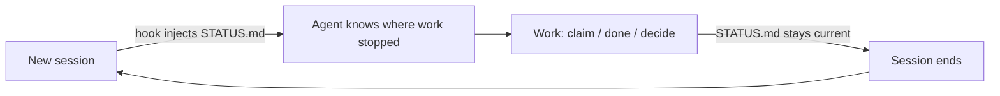

# where-were-we

**English** | [한국어](README.ko.md)

**Your coding agent forgets everything when the session ends. where-were-we makes sure the next session doesn't start from zero.**


One short `STATUS.md` (50 lines max) that says where the work is *right now*: what's in progress, what you already ruled out, what's blocked and what you decided. Every new session reads it first.

```
You:    where were we?

Agent:  Yesterday we were wiring up the Toss payment callback.
        - The checkout window works; the approval callback returns 401.
        - Secret-key encoding was already checked. It's not that.
        - The test key looked expired, and you were going to reissue it.
        Did you get the new key?
```

The agent remembers nothing from yesterday. It read three lines in `STATUS.md`, so it doesn't redo yesterday's debugging, doesn't reopen settled decisions, and starts with what you were waiting on.

---

## Quick start

In Claude Code:

```
/plugin marketplace add jsha2217/where-were-we
/plugin install where-were-we@where-were-we
```

Then, inside a project:

```
set up where-were-we
```

The agent asks one question (keep the records on this computer, or commit them to Git), creates the files and asks for your goal. That's it. From then on you just work.

---

## How it works



Three plain Markdown files, nothing else:

```
STATUS.md                       # where work is now — max 50 lines, read every session
.where-were-we/decisions.md     # every decision, one line each — searched when needed
.where-were-we/log/YYYY-MM.md   # finished work by month — opened when needed
```

Only `STATUS.md` is read every session, so the token cost stays flat no matter how long the project runs. Finished work moves to the log and old decisions fold into one line. Nothing piles up.

### What STATUS.md looks like

```markdown
# Status
_updated: 2026-11-04_

## Goal
- Ship OAuth login for the web app

## Now
- [ ] Google OAuth callback — not cache or lock; suspect handlers.py

## Next
- GitHub OAuth
- Session expiry tests

## Blocked
- [user] Add a payment card to the Fly.io account

## Decisions
- D-002: Postgres, not SQLite — concurrent writers
- D-003: Server-side sessions, not JWT — need instant revoke
- D-004: Redis cache, not in-memory — several instances planned
- D-005: Google first, then GitHub — most users have Google
- D-006: Redis cache only for sessions — replaces D-004
- (+1 older: .where-were-we/decisions.md)
```

| Section | Holds | Changed by |
|---|---|---|
| **Goal** | What the project is trying to achieve now | hand |
| **Now** | Work in progress, plus what was ruled out | `claim` / `done` |
| **Next** | What comes after | hand, `claim` takes from it |
| **Blocked** | What is waiting on someone: `[user]`, `[external]` or `[agent]` | hand |
| **Decisions** | The five latest decisions | `decide` |

---

## Just talk

You don't run commands. You say what's happening, and the skill tells the agent what to record.

| You say | The agent runs |
|---|---|
| "where were we?" / "어디까지 했지?" | reads `STATUS.md` |
| "let's start on GitHub OAuth" | `claim "GitHub OAuth"` |
| "that's done" | `done` → moves the item to the log |
| "let's go with Postgres, not SQLite" | `decide "Postgres, not SQLite — concurrent writers"` |
| "actually, switch back to SQLite" | `decide "SQLite, not Postgres — single user; replaces D-002"` |

Mid-debugging, the agent adds what it ruled out to the Now line, so a crashed or closed session never costs you the same hour twice.

---

## Local or in Git

Chosen once at setup:

| | Local (`init --local`) | In Git (`init --git`) |
|---|---|---|
| In Git | No, excluded through `.git/info/exclude` | Yes, commit it like any file |
| Who picks up | Your next session on this machine | Anyone who clones or forks, on any machine |
| Good for | Your own notes; clean commits; survives branch switches | Handoff between people and computers |

With `--git`, pushing the repo *is* the handoff: whoever clones it gets a session that already knows where work stopped. It never stages, commits or pushes on its own. You can switch to `--local` later; past commits stay as they are.

---

## Why it's built this way

- **Small on purpose.** 50 lines is enough to resume and too little to rot. The limit is a guideline the agent follows, and `check` reports it. Nothing is cut automatically, so nothing you still need disappears.
- **Notes, not instructions.** If `STATUS.md` ever tells the agent to do something, the agent tells you instead of doing it. A committed file can't become a prompt-injection channel.
- **Safe with parallel agents.** Several windows and subagents can write at once. Writes take turns through a lock and replace files atomically.
- **Crash-safe.** If `done` or `decide` is cut off halfway, the next command finishes it with no duplicates and no lost records.
- **Decisions keep their history.** A reversed decision isn't deleted. The new one names what it replaces, so "why did we do this?" always has an answer.
- **Zero dependencies.** One Python file, standard library only. No server, no database, no account.

---

## Compared to

| Approach | Where it falls short |
|---|---|
| Resuming the old conversation | Heavy once it grows; can't move to another machine or person |
| Notes in `CLAUDE.md` | Mixes rules with status; grows forever and goes stale |
| The agent's built-in memory | Remembers you, not the state of the work; not in the repo |
| `git log` | Only finished work. No in-progress, blocked or next |

---

## Other agents

| | Claude Code (plugin) | Other agents (plain skill) |
|---|---|---|
| Commands (`status.py`) | ✅ | ✅ wherever Python runs |
| Skill instructions (`SKILL.md`) | ✅ | ✅ in agents that load Agent Skills |
| `STATUS.md` read automatically at session start | ✅ hook | ❌ not yet. Ask "where were we" and the skill reads it |
| Reminder to update after a commit | ✅ hook | ❌ |

For a plain skill, copy `skills/where-were-we/` into your agent's skills folder. In Claude Code without the plugin, add `--link` to `init`: it adds a short read-this-first block to `CLAUDE.local.md`. Automatic reading for other agents through `AGENTS.md` is planned.

---

## Commands

Run from anywhere inside the project:

```sh
python3 skills/where-were-we/scripts/status.py <command>
```

| Command | What it does |
|---|---|
| `init [--local \| --git] [--link]` | Set up. Asks for the mode when run interactively; agents pass it. `--link`: point `CLAUDE.local.md` at `STATUS.md` |
| `claim 2` / `claim "OAuth"` | Start work: Next item 2 (or the one matching the text) moves into Now; new text is added |
| `done` / `done "OAuth"` | Finish a Now item and log it |
| `decide "Use X, not Y — because Z"` | Record a decision; `STATUS.md` shows the five latest |
| `check` | Under 50 lines, every section present? |

Edit Goal, Next and Blocked by hand. Change Now only through `claim` and `done`.

---

## FAQ

**What if STATUS.md grows past 50 lines?**
Nothing breaks. `check` reports it, and the agent trims: finishes items, prunes Next, removes resolved blockers.

**Do decisions ever get cleaned up?**
`STATUS.md` always shows only the five latest. `decisions.md` keeps everything, since it's only searched, never loaded whole. To reverse a decision, record a new one that says what it replaces. On the same subject, the higher number wins.

**`done` or `decide` was interrupted. Now what?**
Run `claim`, `done` or `decide` again; it finishes the interrupted one first, with no duplicates. If `STATUS.md` or the log was edited by hand in between, it stops instead of overwriting your edit. Check the files, then delete `.where-were-we/.done-pending.json` or `.decide-pending.json` to continue.

**Should I put secrets in it?**
No. Every session reads it, and with `--git` it's committed.

**How do I remove it from a project?**
Delete `STATUS.md` and `.where-were-we/`, the block between the `where-were-we` markers in `CLAUDE.local.md`, and the marked block in `.git/info/exclude`. With `--git`, commit the removal as usual.

---

## Status

**1.0.** Tested on macOS and Linux with Python 3.9, 3.12 and 3.14. Windows is not verified yet.

## Development

```sh
bash tests/run.sh
```

Every test runs in its own temporary `HOME` and Git repositories; nothing outside a temp folder is touched.

```
.claude-plugin/        plugin.json, marketplace.json
hooks/hooks.json       SessionStart and Stop hooks
skills/where-were-we/  SKILL.md and scripts/status.py
tests/                 run.sh, shell and Python tests
```

## Contact

Bugs and ideas: [GitHub issues](https://github.com/jsha2217/where-were-we/issues). Anything else: calumet.embassy5e@icloud.com

## License

[MIT](LICENSE)

```text
MIT License

Copyright (c) 2026 jsha2217

Permission is hereby granted, free of charge, to any person obtaining a copy
of this software and associated documentation files (the "Software"), to deal
in the Software without restriction, including without limitation the rights
to use, copy, modify, merge, publish, distribute, sublicense, and/or sell
copies of the Software, and to permit persons to whom the Software is
furnished to do so, subject to the following conditions:

The above copyright notice and this permission notice shall be included in all
copies or substantial portions of the Software.

THE SOFTWARE IS PROVIDED "AS IS", WITHOUT WARRANTY OF ANY KIND, EXPRESS OR
IMPLIED, INCLUDING BUT NOT LIMITED TO THE WARRANTIES OF MERCHANTABILITY,
FITNESS FOR A PARTICULAR PURPOSE AND NONINFRINGEMENT. IN NO EVENT SHALL THE
AUTHORS OR COPYRIGHT HOLDERS BE LIABLE FOR ANY CLAIM, DAMAGES OR OTHER
LIABILITY, WHETHER IN AN ACTION OF CONTRACT, TORT OR OTHERWISE, ARISING FROM,
OUT OF OR IN CONNECTION WITH THE SOFTWARE OR THE USE OR OTHER DEALINGS IN THE
SOFTWARE.
```
